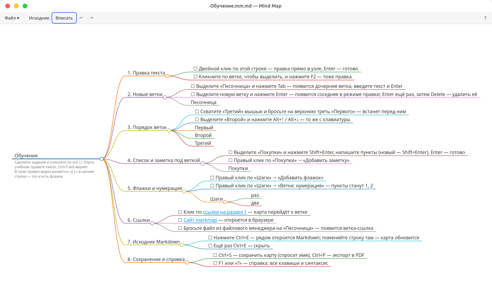

# Mind Map – ein leichter Editor auf Basis von markmap

[Русский](README.md) · [English](README.en.md) · [Español](README.es.md) · [Français](README.fr.md) · **Deutsch** · [中文](README.zh.md)

*Lightweight offline mind map editor for Linux and macOS (GTK3 + WebKit2GTK, Swift + WKWebView, markmap): Markdown, FreeMind, OPML, XMind, PDF export. MIT.*



*Leichter Offline-Editor für Mindmaps unter Linux und macOS (GTK3 + WebKit2GTK, Swift + WKWebView, markmap): Markdown, FreeMind, OPML, XMind, PDF-Export. MIT.*

Mindmaps unter Linux und macOS ansehen und bearbeiten. GTK3 + WebKit2GTK (Systempakete); darin laufen [markmap](https://github.com/markmap/markmap) 0.18.12 und d3 7.9.0, die lokal in `web/vendor/` liegen – ein Netzwerk wird nicht benötigt.

## Start

```sh
./mindmap.py [karte.mm.md|.mm|.opml|.xmind]
./mindmap.py karte.mm.md --pdf karte.pdf     # Export ohne Oberfläche
```

Abhängigkeiten (Debian/Ubuntu): `python3-gi gir1.2-gtk-3.0 gir1.2-webkit2-4.1`.

## Installation

```sh
./build.sh [Version]     # Standard 0.4.2 → dist/mindmap_0.4.2_all.deb und dist/mindmap.run
sudo apt install ./dist/mindmap_0.4.2_all.deb
```

Das Paket installiert den Befehl `mindmap`, die Verknüpfung „Mind Map“ im Anwendungsmenü, das Symbol und die Dateitypen; die Abhängigkeiten zieht apt nach.

`mindmap.run` – dasselbe in einer einzigen Datei ohne Installation (ohne Verknüpfung und Dateitypen): Beim ersten Start entpackt es sich nach `~/.cache/mindmap/<Hash>/`, danach startet es sofort. GTK/WebKit sind nicht enthalten – die Systempakete aus der Liste oben werden benötigt.

### Dateiendung: `.mm.md`

Karten sollten z. B. `plan.mm.md` heißen – so nennt sie auch markmap (Erweiterung für VS Code). Das ist gewöhnliches Markdown: GitHub zeigt es an und jeder Editor öffnet es, aber es hat einen eigenen Typ `text/x-markmap`, und ein Doppelklick öffnet die Karte. Gewöhnliche `.md`-Dateien bleiben Ihrem Markdown-Editor vorbehalten; Mind Map steht für sie unter „Öffnen mit“ bereit. Eine neue Karte wird standardmäßig als `mindmap.mm.md` gespeichert.

Das Paket registriert außerdem `.mm` (FreeMind/Freeplane) und `.xmind` – in der Standard-Typdatenbank gibt es sie nicht (`.mm` ist dort troff). Mind Map zur Standardanwendung machen:

```sh
xdg-mime default mindmap.desktop text/x-markmap application/x-freemind application/vnd.xmind.workbook text/x-opml+xml
```

## macOS

`MindMap-<Version>.dmg` aus den Releases: öffnen und Mind Map in „Programme“ ziehen. Universal-Build (Intel und Apple Silicon), ab macOS 11. Automatisch getestet unter macOS 14 (Intel); auf Apple Silicon nicht getestet.

Die App ist nicht mit einem Apple-Zertifikat signiert, daher blockiert macOS den ersten Start:

- macOS 14 und älter: Rechtsklick auf Mind Map in „Programme“ → „Öffnen“ → „Öffnen“;
- macOS 15 und neuer: Öffnen versuchen, dann „Systemeinstellungen“ → „Datenschutz & Sicherheit“ → „Dennoch öffnen“;
- oder im Terminal: `xattr -dr com.apple.quarantine /Applications/MindMap.app`.

Danach startet sie normal. Doppelklick öffnet `.mm`, `.opml` und `.xmind`, `.md` über „Öffnen mit“. Tastenkürzel mit ⌘ statt Ctrl. Export ohne Oberfläche: `/Applications/MindMap.app/Contents/MacOS/mindmap karte.mm.md --pdf karte.pdf` (die Karte wird auf dem Bildschirm gezeichnet, der Bildschirm darf also nicht im Ruhezustand sein).

Gebaut wird auf einem Mac mit Command Line Tools (`xcode-select --install`), gesteuert von Linux per ssh:

```sh
MAC=user@host macos/build.sh [Version]     # → dist/MindMap-<Version>.dmg
MAC=user@host python3 tests/test_mac.py    # auf dem Mac: Start, PDF, Formate, Sprachen
```

## Funktionen

- Sprachen von Oberfläche, Hilfe und Lernkarte: Russisch, Englisch, Spanisch, Französisch, Deutsch, Chinesisch (vereinfacht). Die Auswahl folgt der Systemsprache, für alle anderen gilt Englisch; erzwingen mit `LANGUAGE=de mindmap`.
- Zoom: Mausrad, Zwei-Finger-Zoom auf dem Touchpad, `Ctrl+=` / `Ctrl+-`; `Ctrl+0` – in das Fenster einpassen.
- Karten erstellen und bearbeiten: im Graphen (Doppelklick auf Namen oder Liste, Kontextmenü, Tasten) und im Markdown-Quelltext (`Ctrl+E` – ein-/ausblenden). Beide Seiten bleiben synchron.
- Hilfe – `F1` oder „?“; „Datei → Lernkarte“ – eine Übungskarte mit Aufgaben als Kontrollkästchen.
- Text wird direkt im Knoten bearbeitet, ohne separates Feld darüber.
- „Anfassen und ziehen“: einen Zweig am Namen auf das obere Drittel eines anderen Zweigs (davor einfügen), das untere (danach) oder die Mitte (als Unterzweig) ziehen. Am Rand der Fläche (40 px) scrollt sie von selbst. Esc bricht ab, Ctrl+Z macht rückgängig. Eine leere Stelle zu ziehen verschiebt die Fläche.
- Links: `[Website](https://…)` – im Browser; `[Datei](./Unterlagen/kostenvoranschlag.pdf)`, `[Ordner](~/Dokumente)` – Sprung in den Dateimanager mit Markierung (es wird nichts ausgeführt); `[Karte](netzwerk.md)` – wird hier geöffnet; `[siehe](#knotenname)` – Sprung zum Knoten. Relative Pfade gelten ab dem Ordner der Karte.
- Eine Datei oder einen Link auf einen Knoten ziehen – es entsteht ein Link-Unterzweig (bei Bildern ``).
- Nummerierte Listen nach CommonMark (`1.`, `1)`, die erste Nummer bleibt erhalten): „Zweige: Nummerierung“ und „Liste: Nummerierung“ im Zweigmenü, im Listenfeld – „1. “ in der ersten Zeile. Buchstabenlisten gibt es in Markdown nicht.
- Bilder `` in Knoten, Kontrollkästchen `- [ ] Aufgabe` / `- [x] erledigt` (Klick schaltet um).
- Notiz unter dem Knoten – Zeilen `> Text`, Liste – `> - Eintrag`. In .mm/.opml/.xmind werden Notiz und Liste in einem Feld gespeichert.
- Menü „Datei“: Neu, Öffnen, Zuletzt verwendet (10 Dateien), Speichern, Speichern unter, Export als PDF, Beenden (`Ctrl+Q`, fragt bei ungespeicherten Änderungen nach).
- Liste unter dem Knotenstrich – in kleiner Schrift, per Klick auf ▾/▸ zu- und aufklappbar. Sie wird in einem einzigen Feld bearbeitet (Doppelklick auf die Liste, `Shift+Enter` oder Menü): Zeile = Eintrag, `Shift+Enter` – neue Zeile, `Enter` – fertig, `Esc` – abbrechen. Leere Zeilen werden verworfen, ein leeres Feld entfernt die Liste.
- Kontextmenü eines Zweigs: Unterzweig/Nachbarzweig hinzufügen, umbenennen, Farbe (Palette, beliebig, zurücksetzen), zuklappen, nach oben/unten verschieben, eine Ebene höher/tiefer, kopieren/ausschneiden/einfügen, löschen. An einer leeren Stelle: einpassen, alles auf-/zuklappen, Quelltext, PDF.
- Tasten: `Tab`/`Enter` – Unterzweig/Nachbarzweig, `Shift+Enter` – Liste unter dem Knoten, `F2`/`Ctrl+Enter` – bearbeiten, `Del` – löschen, `Leertaste` – zuklappen, Pfeiltasten – navigieren, `Alt+Pfeiltasten` – verschieben, `Ctrl+Z`/`Ctrl+Y` – rückgängig/wiederholen, `Ctrl+N/O/S/Shift+S/P/Q`.
- Formate: Markdown (`.mm.md`, `.md`), FreeMind/Freeplane (`.mm`, XML), OPML (`.opml`, XML), XMind 2020+ (`.xmind`). Das Format beim Speichern richtet sich nach der Dateiendung.
- PDF-Export: vektorbasiert, eine Seite in der Größe der Karte.

## Speicherung in Markdown

Die Struktur besteht aus Überschriften, Listeneinträgen und Absätzen (wie in markmap). Die Zweigfarbe – `<!-- color: #e15759 -->`, das Zuklappen – der reguläre markmap-Kommentar `<!-- markmap: fold -->`. Die Farbe wird an die Nachfahren vererbt.

Die Liste unter dem Knoten ist ein Zitat direkt unter der Knotenzeile (mit der Einrückung des Eintrags), im zugeklappten Zustand trägt sie die Marke `<!-- notes: fold -->`:

```markdown
## Ziele <!-- notes: fold -->
> - Frist: Mai
> - Budget

- Erstes Ziel
  > - Kennzahl: NPS > 40
  - Teilziel
```

Gewöhnliches markmap zeigt ein solches Zitat als Unterknoten an – der Inhalt geht nicht verloren.

## Einschränkungen

- Das Bearbeiten im Graphen bringt das Markdown in die kanonische Form (Listen mit 2 Leerzeichen Einrückung, Leerzeilen um Überschriften). Eine Datei, die nur im Quelltext bearbeitet wurde, wird Byte für Byte gespeichert.
- In `.mm`/`.opml`/`.xmind` bleiben Text, Hierarchie, Zuklappen (außer OPML) und Farbe (außer XMind) erhalten. Die Liste unter dem Knoten wird als Notiz geschrieben: FreeMind `richcontent NOTE`, OPML `_note`, XMind `notes`; ihr Zugeklappt-Zustand gelangt nicht in diese Formate. Die Liste ist einstufig. Symbole, Notizen, Verbindungen und Stile anderer Editoren gehen beim erneuten Speichern verloren.
- XMind 8 (`content.xml`) wird nicht gelesen. Das Öffnen einer gespeicherten `.xmind` in XMind selbst wurde nicht geprüft.
- KaTeX-Formeln und Code-Hervorhebung sind abgeschaltet (sie laden Ressourcen aus dem CDN).
- Ins PDF gelangen nur aufgeklappte Zweige.

## Prüfungen

```sh
python3 tests/test_formats.py  # .mm / .opml / .xmind in web/formats.js gegen die Referenz 0.3.2
python3 tests/test_shell.py    # Hülle mindmap.py: Dateien, Links
node web/mdtree.test.js      # Markdown ⇄ Baum
python3 tests/test_i18n.py   # Übersetzungen web/lang/*.json vollständig, Anker in den Karten gültig
python3 tests/test_ui.py     # Oberfläche in headless Chrome (synthetische Ereignisse)
python3 tests/test_pdf.py    # PDF-Export im echten GTK: die ganze Karte passt auf die Seite (braucht ein Display)
node tests/ui-input.mjs      # Oberfläche mit echter Mauseingabe (Chrome DevTools Protocol)
python3 tests/test_mac.py    # macOS-Build auf dem Mac per ssh (siehe „macOS“)
```

Fehlersuche: `MINDMAP_DEBUG=1 ./mindmap.py` – WebKit-Inspektor und `console.log` auf stdout. Auf dem Mac: `MINDMAP_DEBUG=1 /Applications/MindMap.app/Contents/MacOS/mindmap` – Brückenbefehle und JS-Konsole auf stderr.

## Lizenz

[MIT](LICENSE). In `web/vendor/` liegen markmap (MIT) und d3 (ISC), ihre Lizenzen liegen daneben.
