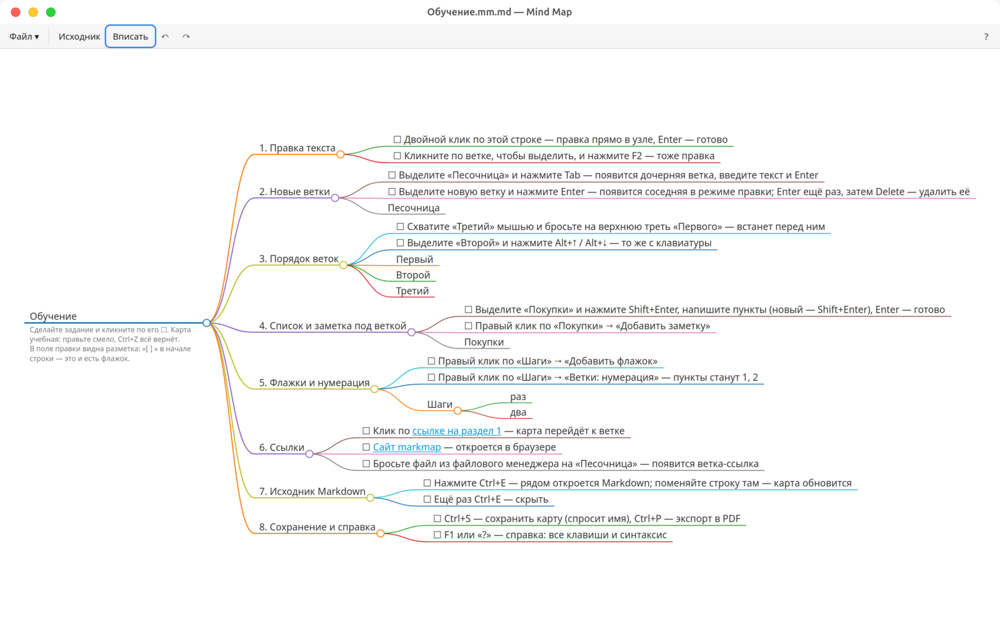

# Mind Map — editor ligero basado en markmap

[Русский](README.md) · [English](README.en.md) · **Español** · [Français](README.fr.md) · [Deutsch](README.de.md) · [中文](README.zh.md)

*Editor ligero y sin conexión de mapas mentales para Linux y macOS (GTK3 + WebKit2GTK, Swift + WKWebView, markmap): Markdown, FreeMind, OPML, XMind, exportación a PDF. MIT.*



Visor y editor de mapas mentales para Linux y macOS. GTK3 + WebKit2GTK (paquetes del sistema); por dentro, [markmap](https://github.com/markmap/markmap) 0.18.12 y d3 7.9.0, que están en local en `web/vendor/`, así que no hace falta red.

## Ejecución

```sh
./mindmap.py [mapa.mm.md|.mm|.opml|.xmind]
./mindmap.py mapa.mm.md --pdf mapa.pdf     # exportación sin interfaz
```

Dependencias (Debian/Ubuntu): `python3-gi gir1.2-gtk-3.0 gir1.2-webkit2-4.1`.

## Instalación

```sh
./build.sh [versión]     # por defecto 0.4.1 → dist/mindmap_0.4.1_all.deb y dist/mindmap.run
sudo apt install ./dist/mindmap_0.4.1_all.deb
```

El paquete instala el comando `mindmap`, el lanzador «Mind Map» en el menú de aplicaciones, el icono y los tipos de archivo; apt se encarga de las dependencias.

`mindmap.run` es lo mismo en un solo archivo, sin instalación (sin lanzador ni tipos de archivo): en el primer arranque se despliega en `~/.cache/mindmap/<hash>/` y después arranca de inmediato. No incluye GTK/WebKit: hacen falta los paquetes del sistema de la lista anterior.

### Extensión de archivo: `.mm.md`

Conviene llamar a los mapas `plan.mm.md`, igual que los llama markmap (la extensión para VS Code). Es Markdown normal: GitHub lo muestra y cualquier editor lo abre, pero tiene su propio tipo `text/x-markmap`, y un doble clic abre el mapa. Los `.md` normales siguen asignados a su editor de Markdown; Mind Map queda para ellos en «Abrir con». Por defecto, un mapa nuevo se guarda como `mindmap.mm.md`.

El paquete registra además `.mm` (FreeMind/Freeplane) y `.xmind`, que no están en la base estándar de tipos (allí `.mm` es troff). Para hacer de Mind Map la aplicación predeterminada:

```sh
xdg-mime default mindmap.desktop text/x-markmap application/x-freemind application/vnd.xmind.workbook text/x-opml+xml
```

## macOS

`MindMap-<versión>.dmg` de las versiones publicadas: ábralo y arrastre Mind Map a Aplicaciones. Compilación universal (Intel y Apple Silicon), macOS 11 o posterior. Probado automáticamente en macOS 14 (Intel); no probado en Apple Silicon.

La aplicación no está firmada con un certificado de Apple, así que macOS bloquea el primer arranque:

- macOS 14 y anteriores: clic derecho en Mind Map en Aplicaciones → Abrir → Abrir;
- macOS 15 y posteriores: intente abrirla y luego Ajustes del Sistema → Privacidad y seguridad → Abrir igualmente;
- o en Terminal: `xattr -dr com.apple.quarantine /Applications/MindMap.app`.

Después arranca con normalidad. El doble clic abre `.mm`, `.opml` y `.xmind`; `.md`, con «Abrir con». Los atajos usan ⌘ en lugar de Ctrl. Exportar sin interfaz: `/Applications/MindMap.app/Contents/MacOS/mindmap mapa.mm.md --pdf mapa.pdf` (el mapa se dibuja en pantalla, así que la pantalla no debe estar en reposo).

La compilación se hace en un Mac con Command Line Tools (`xcode-select --install`) y se lanza desde Linux por ssh:

```sh
MAC=user@host macos/build.sh [versión]     # → dist/MindMap-<versión>.dmg
MAC=user@host python3 tests/test_mac.py    # en el Mac: arranque, PDF, formatos, idiomas
```

## Funciones

- Idiomas de la interfaz, la ayuda y el tutorial: ruso, inglés, español, francés, alemán, chino (simplificado). Se elige según la configuración regional del sistema; para los demás, inglés; para forzarlo, `LANGUAGE=de mindmap`.
- Zoom: rueda, pellizco en el panel táctil, `Ctrl+=` / `Ctrl+-`; `Ctrl+0` ajusta a la ventana.
- Creación y edición del mapa: en el grafo (doble clic en el nombre o la lista, menú contextual, teclas) y en la fuente Markdown (`Ctrl+E` la muestra u oculta). Ambos lados se sincronizan.
- Ayuda: `F1` o «?»; «Archivo → Tutorial» abre un mapa de aprendizaje con tareas en forma de casillas.
- La edición del texto se hace directamente en el nodo, sin un campo aparte encima.
- «Agarrar y arrastrar»: una rama, por el nombre, sobre el tercio superior de otra rama (insertar antes), el inferior (después) o el centro (hacerla hija). Junto al borde del lienzo (40 px) este se desplaza solo. Esc cancela, Ctrl+Z deshace. Al arrastrar el espacio vacío se mueve el lienzo.
- Enlaces: `[sitio](https://…)` se abre en el navegador; `[archivo](./docs/presupuesto.pdf)`, `[carpeta](~/Documentos)` llevan al gestor de archivos con el elemento seleccionado (no se ejecuta nada); `[mapa](red.md)` se abre aquí; `[véase](#nombre-del-nodo)` salta al nodo. Las rutas relativas se cuentan desde la carpeta del mapa.
- Se puede soltar un archivo o un enlace sobre un nodo: aparece una rama hija con el enlace (una imagen, como ``).
- Listas numeradas según CommonMark (`1.`, `1)`, se conserva el primer número): «Ramas: numeración» y «Lista: numeración» en el menú de la rama; en el campo de la lista, «1. » en la primera línea. En Markdown no hay listas con letras.
- Imágenes `` en los nodos, casillas `- [ ] tarea` / `- [x] hecho` (un clic las alterna).
- Una nota bajo el nodo son líneas `> texto`; una lista, `> - elemento`. En .mm/.opml/.xmind la nota y la lista se guardan en un único campo.
- Menú «Archivo»: nuevo, abrir, guardar, guardar como, exportar a PDF, salir (`Ctrl+Q`, preguntará por lo no guardado).
- La lista bajo la línea del nodo va en letra pequeña y se contrae con un clic en ▾/▸. Se edita en un solo campo (doble clic en la lista, `Shift+Enter` o el menú): una línea = un elemento, `Shift+Enter` nueva línea, `Enter` listo, `Esc` cancelar. Las líneas vacías se descartan; un campo vacío elimina la lista.
- Menú contextual de la rama: añadir hija/hermana, renombrar, color (paleta, personalizado, quitar), contraer, mover arriba/abajo, subir/bajar de nivel, copiar/cortar/pegar, eliminar. En el espacio vacío: ajustar, expandir/contraer todo, fuente, PDF.
- Teclas: `Tab`/`Enter` rama hija/hermana, `Shift+Enter` lista bajo el nodo, `F2` editar, `Supr` eliminar, `Espacio` contraer, flechas para navegar, `Alt+flechas` para mover, `Ctrl+Z`/`Ctrl+Y` deshacer/rehacer, `Ctrl+N/O/S/Shift+S/P/Q`.
- Formatos: Markdown (`.mm.md`, `.md`), FreeMind/Freeplane (`.mm`, XML), OPML (`.opml`, XML), XMind 2020+ (`.xmind`). El formato al guardar se elige por la extensión.
- Exportación a PDF: vectorial, una página del tamaño del mapa.

## Almacenamiento en Markdown

La estructura son los títulos, los elementos de lista y los párrafos (como en markmap). El color de la rama es `<!-- color: #e15759 -->`; el plegado, el comentario estándar de markmap `<!-- markmap: fold -->`. El color lo heredan los descendientes.

La lista bajo un nodo es una cita justo debajo de la línea del nodo (con la sangría del elemento); si está contraída, lleva la marca `<!-- notes: fold -->`:

```markdown
## Objetivos <!-- notes: fold -->
> - plazo: mayo
> - presupuesto

- Primer objetivo
  > - métrica: NPS > 40
  - subobjetivo
```

El markmap normal mostrará esa cita como un nodo hijo: el contenido no se pierde.

## Limitaciones

- La edición en el grafo lleva el Markdown a su forma canónica (listas con sangría de 2 espacios, líneas vacías alrededor de los títulos). Un archivo editado solo en la fuente se guarda byte a byte.
- En `.mm`/`.opml`/`.xmind` se conservan el texto, la jerarquía, el plegado (salvo en OPML) y el color (salvo en XMind). La lista bajo el nodo se escribe como nota: FreeMind `richcontent NOTE`, OPML `_note`, XMind `notes`; su estado contraído no pasa a esos formatos. La lista es de un solo nivel. Los iconos, las notas, las relaciones y los estilos de otros editores se pierden al volver a guardar.
- XMind 8 (`content.xml`) no se lee. No se ha comprobado abrir un `.xmind` guardado en el propio XMind.
- Las fórmulas KaTeX y el resaltado de código están desactivados (cargan recursos de una CDN).
- En el PDF solo entran las ramas expandidas.

## Pruebas

```sh
python3 tests/test_formats.py  # .mm / .opml / .xmind en web/formats.js frente a la referencia 0.3.2
python3 tests/test_shell.py    # envoltorio mindmap.py: archivos, enlaces
node web/mdtree.test.js      # Markdown ⇄ árbol
python3 tests/test_i18n.py   # las traducciones web/lang/*.json están completas, los anclajes de los mapas funcionan
python3 tests/test_ui.py     # interfaz en Chrome headless (eventos sintéticos)
python3 tests/test_pdf.py    # exportación a PDF en GTK real: el mapa cabe entero en la página (requiere pantalla)
node tests/ui-input.mjs      # interfaz con entrada real de ratón (Chrome DevTools Protocol)
python3 tests/test_mac.py    # compilación macOS en el Mac por ssh (véase «macOS»)
```

Depuración: `MINDMAP_DEBUG=1 ./mindmap.py` — inspector de WebKit y `console.log` en stdout. En Mac: `MINDMAP_DEBUG=1 /Applications/MindMap.app/Contents/MacOS/mindmap` — órdenes del puente y consola JS en stderr.

## Licencia

[MIT](LICENSE). En `web/vendor/` están markmap (MIT) y d3 (ISC); sus licencias están junto a ellos.
