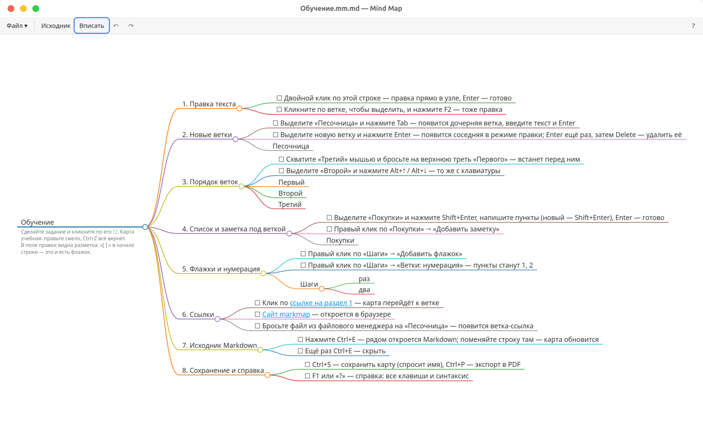

# Mind Map — 基于 markmap 的轻量思维导图编辑器

[Русский](README.md) · [English](README.en.md) · [Español](README.es.md) · [Français](README.fr.md) · [Deutsch](README.de.md) · **中文**

*适用于 Linux 和 macOS 的轻量离线思维导图编辑器（GTK3 + WebKit2GTK、Swift + WKWebView、markmap）：Markdown、FreeMind、OPML、XMind、PDF 导出。MIT 许可。*



在 Linux 和 macOS 下查看和编辑思维导图。GTK3 + WebKit2GTK（系统软件包），内置 [markmap](https://github.com/markmap/markmap) 0.18.12 和 d3 7.9.0，存放在本地的 `web/vendor/` 中，无需联网。

## 运行

```sh
./mindmap.py [导图.mm.md|.mm|.opml|.xmind]
./mindmap.py 导图.mm.md --pdf 导图.pdf     # 无界面导出
```

依赖（Debian/Ubuntu）：`python3-gi gir1.2-gtk-3.0 gir1.2-webkit2-4.1`。

## 安装

```sh
./build.sh [版本]     # 默认 0.4.0 → dist/mindmap_0.4.0_all.deb 和 dist/mindmap.run
sudo apt install ./dist/mindmap_0.4.0_all.deb
```

软件包会安装 `mindmap` 命令、应用程序菜单中的“Mind Map”启动器、图标和文件类型，依赖由 apt 自动安装。

`mindmap.run` 是免安装的单文件版本（没有启动器和文件类型）：首次运行时解压到 `~/.cache/mindmap/<哈希>/`，之后直接启动。其中不含 GTK/WebKit——需要上面列出的系统软件包。

### 文件扩展名：`.mm.md`

建议把导图命名为 `计划.mm.md`——与 markmap 的命名方式一致（VS Code 扩展使用的扩展名）。它就是普通的 Markdown：GitHub 可以显示，任何编辑器都能打开，但它有自己的类型 `text/x-markmap`，双击即可打开导图。普通的 `.md` 仍归您的 Markdown 编辑器，Mind Map 在“打开方式”中可选。新建导图默认保存为 `mindmap.mm.md`。

软件包还注册了 `.mm`（FreeMind/Freeplane）和 `.xmind`——标准类型库中没有它们（那里的 `.mm` 是 troff）。将 Mind Map 设为默认应用：

```sh
xdg-mime default mindmap.desktop text/x-markmap application/x-freemind application/vnd.xmind.workbook text/x-opml+xml
```

## macOS

从发布页下载 `MindMap-<版本>.dmg`：打开后把 Mind Map 拖进“应用程序”。通用版本（Intel 和 Apple Silicon），需要 macOS 11 或更高版本。已在 macOS 14（Intel）上自动测试；未在 Apple Silicon 上测试。

应用没有 Apple 证书签名，因此 macOS 会拦截首次启动：

- macOS 14 及更早：在“应用程序”中右键点按 Mind Map →“打开”→“打开”；
- macOS 15 及更新：先尝试打开，然后进入“系统设置”→“隐私与安全性”→“仍要打开”；
- 或在终端中执行：`xattr -dr com.apple.quarantine /Applications/MindMap.app`。

之后即可正常启动。双击可打开 `.mm`、`.opml` 和 `.xmind`，`.md` 请用“打开方式”。快捷键用 ⌘ 代替 Ctrl。无界面导出：`/Applications/MindMap.app/Contents/MacOS/mindmap 导图.mm.md --pdf 导图.pdf`（导图在屏幕上绘制，显示器不能处于睡眠状态）。

在装有 Command Line Tools（`xcode-select --install`）的 Mac 上构建，从 Linux 通过 ssh 驱动：

```sh
MAC=user@host macos/build.sh [版本]        # → dist/MindMap-<版本>.dmg
MAC=user@host python3 tests/test_mac.py    # 在 Mac 上：启动、PDF、格式、语言
```

## 功能

- 界面、帮助和教程的语言：俄语、英语、西班牙语、法语、德语、简体中文。按系统区域设置自动选择，其他情况使用英语；强制指定——`LANGUAGE=de mindmap`。
- 缩放：滚轮、触摸板双指缩放、`Ctrl+=` / `Ctrl+-`；`Ctrl+0`——适应窗口。
- 创建和编辑导图：在图上（双击名称或列表、右键菜单、按键）和在 Markdown 源码中（`Ctrl+E`——显示/隐藏）。两边保持同步。
- 帮助——`F1` 或“?”；“文件 → 教程”——带复选框任务的练习导图。
- 文字直接在节点中编辑，不会在上面再弹出单独的输入框。
- “抓住就拖”：拖动分支名称——放到另一分支的上三分之一（插入到它之前）、下三分之一（之后）或中间（成为它的子分支）。靠近画布边缘（40 px）时画布自动滚动。Esc 取消，Ctrl+Z 撤销。拖动空白处可平移画布。
- 链接：`[网站](https://…)`——在浏览器中打开；`[文件](./文档/预算.pdf)`、`[文件夹](~/文档)`——在文件管理器中定位并选中（不会运行任何程序）；`[导图](网络.md)`——在此打开；`[见](#节点名称)`——跳转到节点。相对路径以导图所在文件夹为基准。
- 可以把文件或链接拖到节点上——会出现子链接分支（图片为 ``）。
- 按 CommonMark 的编号列表（`1.`、`1)`，保留第一个编号）：分支菜单中的“分支：编号”和“列表：编号”，在列表输入框中第一行写“1. ”。Markdown 中没有字母列表。
- 节点中的图片 ``，复选框 `- [ ] 待办` / `- [x] 已完成`（点击切换）。
- 节点下的备注——以 `> 文字` 开头的行，列表——`> - 项目`。在 .mm/.opml/.xmind 中，备注和列表存放在同一个字段里。
- “文件”菜单：新建、打开、保存、另存为、导出为 PDF、退出（`Ctrl+Q`，有未保存内容时会询问）。
- 节点横线下的列表——小字，点击 ▾/▸ 折叠。用一个输入框编辑（双击列表、`Shift+Enter` 或菜单）：一行一项，`Shift+Enter`——换行，`Enter`——完成，`Esc`——取消。空行会被丢弃，输入框为空则移除列表。
- 分支右键菜单：添加子分支/同级分支、重命名、颜色（调色板、自定义、重置）、折叠、上移/下移、升级/降级、复制/剪切/粘贴、删除。在空白处：适应窗口、全部展开/折叠、源码、PDF。
- 按键：`Tab`/`Enter`——子分支/同级分支，`Shift+Enter`——节点下的列表，`F2`——编辑，`Del`——删除，`空格`——折叠，方向键——导航，`Alt+方向键`——移动，`Ctrl+Z`/`Ctrl+Y`——撤销/重做，`Ctrl+N/O/S/Shift+S/P/Q`。
- 格式：Markdown（`.mm.md`、`.md`）、FreeMind/Freeplane（`.mm`，XML）、OPML（`.opml`，XML）、XMind 2020+（`.xmind`）。保存时的格式由扩展名决定。
- 导出为 PDF：矢量，单页，大小与导图一致。

## 以 Markdown 存储

结构——标题、列表项、段落（与 markmap 相同）。分支颜色——`<!-- color: #e15759 -->`，折叠——markmap 标准注释 `<!-- markmap: fold -->`。颜色由下级继承。

节点下的列表——紧接在节点行下方的引用块（与列表项同缩进），折叠状态用标记 `<!-- notes: fold -->`：

```markdown
## 目标 <!-- notes: fold -->
> - 期限：五月
> - 预算

- 第一个目标
  > - 指标：NPS > 40
  - 子目标
```

普通的 markmap 会把这样的引用块显示为子节点——内容不会丢失。

## 限制

- 在图上编辑会把 Markdown 规范化（列表缩进 2 个空格，标题前后留空行）。只在源码中编辑的文件会逐字节原样保存。
- 在 `.mm`/`.opml`/`.xmind` 中保留文字、层级、折叠状态（OPML 除外）和颜色（XMind 除外）。节点下的列表写成备注：FreeMind 的 `richcontent NOTE`、OPML 的 `_note`、XMind 的 `notes`；其折叠状态不会写入这些格式。列表只有一层。其他编辑器的图标、备注、关联和样式在重新保存时会丢失。
- 不能读取 XMind 8（`content.xml`）。尚未验证保存的 `.xmind` 能否在 XMind 本身中打开。
- KaTeX 公式和代码高亮已禁用（它们会从 CDN 加载资源）。
- PDF 中只包含已展开的分支。

## 检查

```sh
python3 tests/test_formats.py  # web/formats.js 中的 .mm / .opml / .xmind，对照 0.3.2 基准
python3 tests/test_shell.py    # mindmap.py 外壳：文件、链接
node web/mdtree.test.js      # Markdown ⇄ 树
python3 tests/test_i18n.py   # web/lang/*.json 的翻译完整，导图中的锚点有效
python3 tests/test_ui.py     # 无头 Chrome 中的界面（合成事件）
python3 tests/test_pdf.py    # 在真实 GTK 中导出 PDF：整张导图完整位于页面内（需要显示器）
node tests/ui-input.mjs      # 用真实的鼠标输入测试界面（Chrome DevTools Protocol）
python3 tests/test_mac.py    # 通过 ssh 在 Mac 上测试 macOS 版本（见“macOS”）
```

调试：`MINDMAP_DEBUG=1 ./mindmap.py`——WebKit 检查器，`console.log` 输出到 stdout。 Mac 上：`MINDMAP_DEBUG=1 /Applications/MindMap.app/Contents/MacOS/mindmap`——桥接命令和 JS 控制台输出到 stderr。

## 许可证

[MIT](LICENSE)。`web/vendor/` 中是 markmap（MIT）和 d3（ISC），它们的许可证放在旁边。
